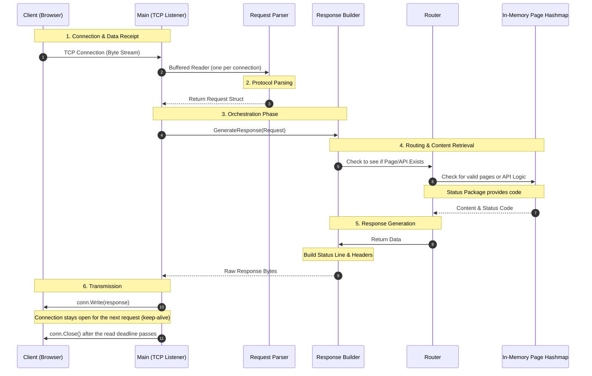
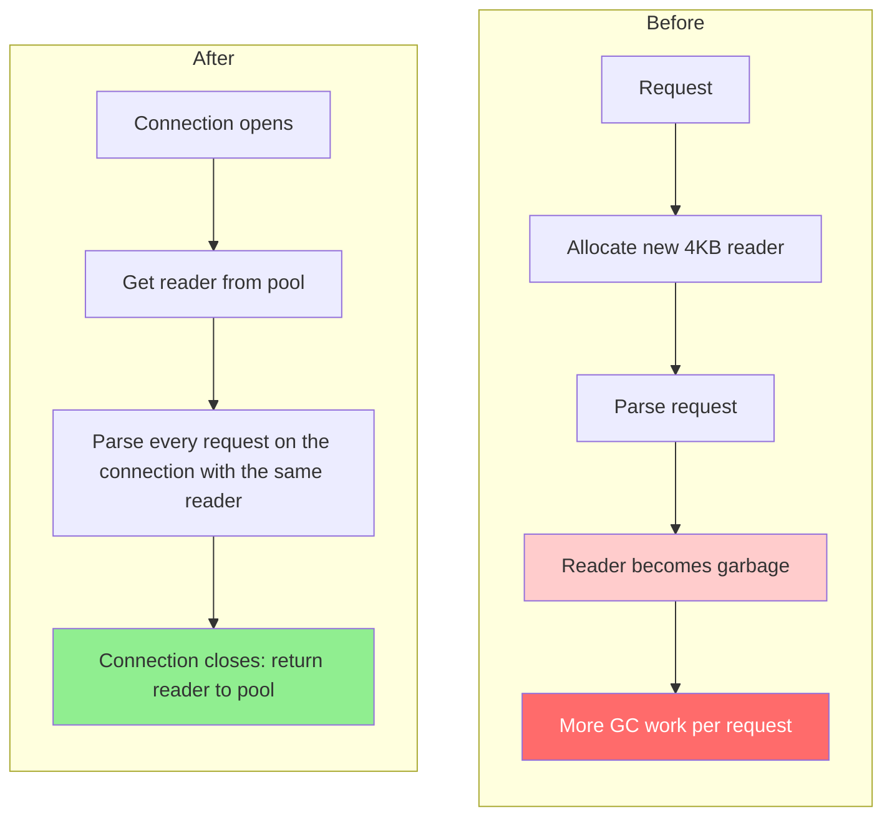

# Go-Raw-HTTP
An HTTP/1.1 web server written in Go on top of raw TCP sockets, without using the `net/http` package


#### My inspiration for this project 

I wanted a deeper understanding of how web servers like nginx and the Apache HTTP Server
work at a low level, and to gain experience working directly with sockets.

#### Current Benchmarks

Run #1 (server warm-up)
| Thread Stats | Avg   | Stdev  | Max     | +/- Stdev |
| ------------ | ----- | ------ | ------- | --------- |
| Latency      | 24.00ms  | 54.50ms  | 456.94ms  | 91.71%    |
| Req/Sec      | 3.53k  | 1.63k  | 5.08k   | 80.49%   |

Requests/sec:  13276.73
Transfer/sec:     13.85MB

Run #2 
| Thread Stats | Avg   | Stdev  | Max     | +/- Stdev |
| ------------ | ----- | ------ | ------- | --------- |
| Latency      | 6.97ms   | 5.14ms  | 89.43ms  | 94.82%    |
| Req/Sec      | 3.84k  | 689.02  | 5.11k   | 72.67%   |

Requests/sec:  15284.58
Transfer/sec:     15.95MB

Run #3
| Thread Stats | Avg   | Stdev  | Max     | +/- Stdev |
| ------------ | ----- | ------ | ------- | --------- |
| Latency      | 8.52ms   | 12.28ms  | 247.07ms  | 95.31%    |
| Req/Sec      | 3.78k  | 1.05k | 5.26k   | 77.75%   |

Requests/sec:  15058.00
Transfer/sec:     15.71MB

Run #4
| Thread Stats | Avg   | Stdev  | Max     | +/- Stdev |
| ------------ | ----- | ------ | ------- | --------- |
| Latency      | 5.97ms   | 2.56ms  | 58.90ms  | 80.79%    |
| Req/Sec      | 4.24k  | 468.23 | 5.18k   | 68.75%   |

Requests/sec:  16891.08
Transfer/sec:     17.62MB

#### Previous Benchmarks

4 threads, 100 concurrent connections 
| Thread Stats | Avg   | Stdev  | Max     | +/- Stdev |
| ------------ | ----- | ------ | ------- | --------- |
| Latency      | 14.37ms   | 21.96ms  | 303.01ms  | 92.48%    |
| Req/Sec      | 2.61k  | 1.06k  | 4.67k   | 61.71%   |

311904 requests in 30.03s
Transfer/sec: 10.83MB

I'm still investigating why some requests have high latency variance (std dev).


#### Features To-Do List


- [x] **TCP Socket Handling**: Accepts connections with `net.Listen` / `Accept` and reads the raw byte stream directly, without `net/http`. (The TCP handshake itself is done by the operating system.)
- [x] **Persistent Connections (Keep-Alive)**: Serves multiple requests over one connection, with a read deadline that closes idle connections.
- [x] **Custom HTTP Status Error Handling**
- [x] **HTTP Request Parser**: Parses the request line, headers, query string, and body from the byte stream into Go structs.
- [x] **HTTP Response Generator**: Builds the status line, headers, and body by hand.
- [x] **Dynamic Route Mapping**: Page/API routing logic 
- [x] **Add CSS and JS support**: Expanding the `In-Memory Page Hashmap` to handle non-HTML assets.
- [ ] **Add TLS**: Implementing secure communication via `crypto/tls`.
- [ ] **Implement GitHub Actions CI/CD**: Automating testing and deployment workflows.
- [x] **Containerize the server via Docker**: Creating a lightweight environment for deployment.
- [ ] **Implement LRU Cache**: Optimizing memory usage for high-traffic static assets.

#### Usage & Setup

1. Clone the repo
```git clone https://github.com/Douty/HTTP_SERVER```
2. Start the server 
``` go run main.go ```
3. In your browser, go to
"http://localhost/"


## System Architecture & Request Lifecycle

# Technical Challenges

### Server Performance Optimization 

**The problem**

Under load (wrk, 100 concurrent connections), average latency was 14.37ms but the worst requests took up to 303ms, and throughput was about 10.4k requests/sec.

**What I found**

On every request, the connection loop created a brand-new 4KB `bufio.Reader` (and request bodies got a newly allocated buffer). With keep-alive, a single connection handles thousands of requests, so this added up to a lot of allocations and extra work for Go's garbage collector. My working theory is that this GC pressure caused most of the latency spikes. I haven't confirmed it with a profiler yet (see Next Steps).

Creating a new reader per request was also a correctness bug: a `bufio.Reader` can read ahead past the end of the current request, and those bytes were thrown away when the next request got a fresh reader.

**The solution**

I create one `bufio.Reader` per connection and reuse it for every request on that connection. Readers come from a `sync.Pool`, so a new connection reuses a reader that a closed connection gave back. Body buffers also come from a pool.

**Results**
| Metric | Before | After  | Improvement |
|--------|--------|-------|-------------|
| **Throughput** | 10,384 req/sec | 16,891 req/sec | **+63%** |
| **Avg Latency** | 14.37 ms | 5.97 ms | **58% lower** |
| **Max Latency** | 303.01 ms | 58.90 ms | **81% lower** |

*The "after" numbers come from the best of four runs. The same change also raised the read deadline from 5s to 10s, so not all of the difference is due to buffer reuse alone.*

## Key Learnings

1. **Per-request allocations add up** - Under keep-alive, anything allocated per request is allocated thousands of times per connection.
2. **Reuse buffers at the right scope** - The biggest win came from tying the reader's lifetime to the connection instead of to each request.
3. **Warm-up matters** - First run: 24ms average latency. Fourth run: 5.97ms average.
4. **Measure, don't guess** - Benchmarks showed the problem; a profiler is the right tool to prove the cause.

## Next Steps

- Confirm the cause of the remaining latency spikes with `pprof` and `GODEBUG=gctrace=1`.
- Remove the per-request debug logging from the hot path.
- Add limits on header size and request body size.

### Handling Keep-Alive: Closing the TCP connection too early

##### TL;DR: 

<b>The problem</b>: When I benchmarked my web server with [wrk](https://github.com/wg/wrk), it reported errors because wrk expects persistent connections, while my server only supported non-persistent connections.

<b>The fix</b>: Instead of closing the connection immediately after sending a response, the server now keeps listening for new requests on the same connection and resets the read deadline for each one. Once the deadline passes with no new request, the server closes the connection.  


##### Detailed: 
###### Initial Goal
I wanted to see how my web server handled load.

So I ran a wrk benchmark with 2 threads and 100 concurrent connections. I immediately spotted something wrong when the test returned:


| Thread Stats | Avg   | Stdev  | Max     | +/- Stdev |
| ------------ | ----- | ------ | ------- | --------- |
| Latency      | 12ms  | 5.36ms | 74.96ms | 78.68%    |
| Req/Sec      | 2.00k | 290.51 | 2.73K   | 71.17%    |

119608 requests in 30.02s, 124.79MB read
socket errors: connect 0, read 119606, write 0, timeout 0

requests/sec: 3984.67
transfer/sec: 4.16 MB
<br>

###### The Problem
119,606 socket read errors was extremely alarming to see.

I first checked the logs inside the Docker container where my web server was running. All the static files had loaded successfully, and every request was being handled properly. 

That led me to the server's `main` file, where the socket connections are handled. Everything appeared correct.

I researched how wrk runs its tests and found that I had overlooked a key `HTTP/1.1` feature: persistent connections (`Connection: keep-alive`). My connection handling was non-persistent. 

> [!NOTE]
> The server would accept the request, generate a response, send it back to the client, and close the connection.
> This is the HTTP/1.0 way of handling connections.

###### The Solution 

In my `handleConnection` function, instead of closing the connection immediately, the server keeps listening for more requests on the same connection until the read deadline passes. 
